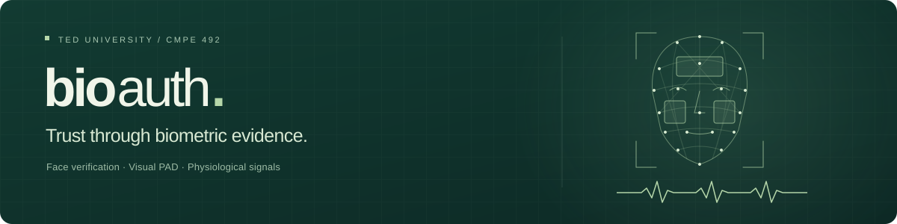

  

  <a href="#about-bioauth">About BioAuth</a>
  &nbsp; · &nbsp;
  <a href="#verification-approach">Our approach</a>
  &nbsp; · &nbsp;
  <a href="#project-team">The team</a>
  &nbsp; · &nbsp;
  <a href="#project-reports">Project reports</a>

## About BioAuth

**BioAuth** is a biometric verification research project by four Computer Engineering students at **TED University**, developed through CMPE 491 and CMPE 492.

Our goal is to make remote identity verification more reliable by considering the quality and trustworthiness of the evidence behind a decision. BioAuth investigates a **quality- and attack-aware fusion engine** that brings together facial identity, presentation attack indicators and physiological signals.

The proposed system supports additional verification before sensitive digital actions. Its representative application covers reviewed account enrollment and step-up verification before a change to an account's payout destination.

## Verification approach

| Evidence | Contribution |
| :--- | :--- |
| **Facial identity** | One-to-one comparison with an approved reference. |
| **Visual presentation** | Independent assessment of presentation attack indicators. |
| **Physiological signals** | Pulse-related colour variations in facial video, examined with remote photoplethysmography (rPPG). |
| **Capture quality** | Context about lighting, motion and measurement reliability. |

The fusion policy considers how reliable these signals are and whether they agree. It supports three explainable outcomes:

- **ACCEPT** · usable evidence supports verification.
- **REJECT** · reliable mismatch or attack evidence prevents verification.
- **RETRY** · a fresh capture is needed to reach a supported decision.

The research compares fixed, quality-weighted and quality- and attack-aware policies to study the balance between security, genuine-user experience, retries and processing cost.

## Project team

**Computer Engineering · TED University**

- **Esra Eda Kılıç**
- **Enes Taşçı**
- **Ömer Taylan Alemdar**
- **Batuhan Mert Korkmaz**

**Project supervisor:** Dr. Ulaş Güleç

**Jury members:** Prof. Dr. Saiful Islam · Prof. Dr. Tolga Kurtuluş Çapın

## Project reports

Our reports document BioAuth's development from the initial problem definition to system architecture and detailed design.

| Course | Document |
| :--- | :--- |
| CMPE 491 | [Project Proposal](public/reports/bioauth-project-proposal.pdf) |
| CMPE 491 | [Project Specifications](public/reports/bioauth-project-specifications.pdf) |
| CMPE 491 | [Project Analysis](public/reports/bioauth-project-analysis.pdf) |
| CMPE 491 | [High-Level Design](public/reports/bioauth-high-level-design.pdf) |
| CMPE 492 | [Low-Level Design · v1](public/reports/bioauth-low-level-design-v1.pdf) |

---

  TED University · Computer Engineering · CMPE 492 
  Academic research prototype · Research and development in progress

